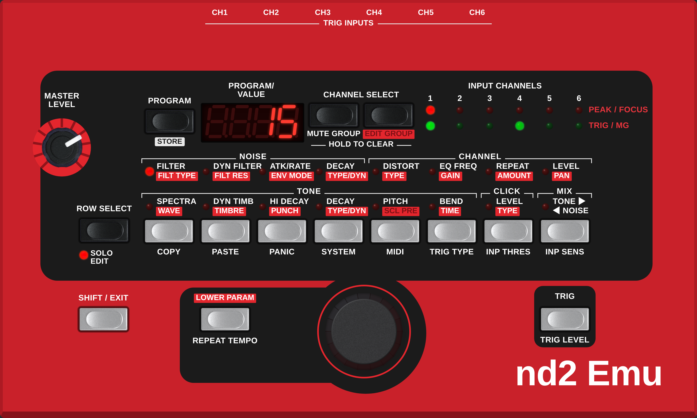

# ND2



Low-level emulation of a classic six-channel drum synthesizer, running its original OS on an emulated
dsPIC33E. VST3, AU and standalone for macOS (Apple Silicon).

## Download

### [Download ND2 for macOS (Apple Silicon): latest version](https://github.com/DustyHammers/ND2-Emu/releases/latest/download/ND2-macOS.zip)

VST3, AU and standalone app in one zip, for macOS 13 or newer. See [Installing on macOS](#installing-on-macos)
below. Earlier versions are on the [releases page](https://github.com/DustyHammers/ND2-Emu/releases).

## What's new

### 0.1.4

- Panel: the strip of jacks above the panel and the output and MIDI labels are gone; CH1 to CH6 are centred.
- The body has a bevelled edge, and the buttons come up through small cutouts in the panel.
- The buttons and the MASTER LEVEL knob have the same sandblasted finish as the value encoder, drawn at twice the
  resolution; the knob is a little larger. The wordmark reads "nd2 Emu".
- The standalone app has its own icon.

### 0.1.3

- Slightly lower CPU use from a faster emulation of the processor. The sound is identical, sample for sample.

### 0.1.2

- Ableton Live: the VST3 no longer crashes when loaded and the AU is accepted. In Live, Trigger In takes one to
  six channels; every other host, REAPER included, keeps the six-channel Trigger In.
- Every build is now tested in a plugin host test (VST3 and AU).

### 0.1.1

- Trigger In takes all six channels (pads 1 to 6) or none. Hosts that asked for a stereo input first got only
  pads 1 and 2.

### 0.1.0

- First public version: VST3, AU and standalone with the default skin. Main output, six stereo channel outputs,
  six trigger inputs, MIDI in and out. Each project saves the complete machine, including presets stored on the
  panel.

## Firmware

No firmware, OS images, ROMs or presets are included in this repository or its releases, and none will
be provided. Please don't ask for them. The emulator needs an OS update file that you obtain yourself;
it is intended for owners of the original hardware.

## Installing on macOS

The builds are not notarised by Apple, so macOS blocks them until the quarantine flag is removed:

1. Copy `ND2.vst3` to `~/Library/Audio/Plug-Ins/VST3/`, `ND2.component` to `~/Library/Audio/Plug-Ins/Components/`
   and `ND2.app` to `/Applications/`.
2. In Terminal, type `sudo xattr -r -d com.apple.quarantine ` (ending with a space), drag the copied file onto the
   Terminal window and press Return. Repeat for each of the three.
3. For the AU, run `killall -9 AudioComponentRegistrar`, then rescan plugins in your host.

On first start, choose the OS update file and then the factory bank files.

## Using the panel

- Buttons: click. **Option-click** holds a button down (for SHIFT or LOWER PARAM combinations); click it again or
  press Esc to release it.
- Encoder and MASTER LEVEL: drag up or down, or use the scroll wheel; hold Shift for fine steps.
- Right-click the panel for skins, zoom, the OS update file and the factory banks.

## Files and folders

ND2 creates `~/Documents/ND2/` the first time it runs, with three folders:

```
~/Documents/ND2/
  os/        your firmware/OS
  skins/     your own skins: a folder <name> containing <name>.rml and its files; listed under right-click > Skin
  cache/     made by ND2, safe to delete:
             factory-<id>.flash        the factory memory built from your bank files (shared by new instances)
             skin-default-<id>/        the built-in skin, unpacked
  skin-log.txt   skin messages, only while right-click > Developer > Write skin log is on
```

Settings shared by all instances (chosen skin, window size, skin log on/off) are in
`~/Library/Application Support/ND2/ND2.settings`. Each project stores its own complete machine, including presets
saved on the panel, so projects don't depend on these folders except for the OS.

Deleting `os/` makes ND2 ask for your firmware/OS again; deleting `cache/` makes it ask for the factory bank files
again (projects keep their own presets).

## Disclaimer

This project is not affiliated with, endorsed by or connected to the manufacturer of the original
hardware. All trademarks belong to their respective owners. The original OS and presets are the
copyright of their owners.

## License

Free and open source under the GNU Affero General Public License v3.0; see `LICENSE`.
