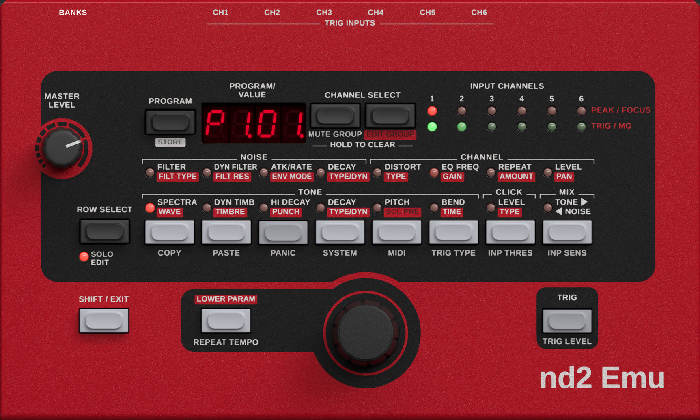

# nd2 Emu



Low-level emulation of a classic six-channel drum synthesizer, running its original OS on an emulated
dsPIC33E. VST3, AU and standalone for macOS (Apple Silicon; Intel is included but untested); VST3 and standalone
for Windows (64-bit).

> **Independent project.** nd2 Emu is a free, non-commercial project. It is not affiliated with, sponsored by or
> endorsed by the manufacturer of the original hardware. All trademarks and product names belong to their
> respective owners. The original OS and the factory sounds are the copyright of their owners: none of them are
> included here, and none will be provided.
>
> Intended for the owners of the original hardware as an emulation, librarian, editor, etc.

## Download

### [Download ND2 for macOS: latest version](https://github.com/DustyHammers/ND2-Emu/releases/latest/download/ND2-macOS.zip)

VST3, AU and standalone app in one zip, for macOS 13 or newer. See [Installing on macOS](#installing-on-macos)
below. Earlier versions are on the [releases page](https://github.com/DustyHammers/ND2-Emu/releases).

### [Download ND2 for Windows: latest version](https://github.com/DustyHammers/ND2-Emu/releases/latest/download/ND2-Windows.zip)

VST3 and standalone app in one zip, for 64-bit Windows 10 or newer. Installing: INSTALL.txt in the zip.

> "Dusty's part was knowing exactly how round a bevel should be and saying "no" to my knob renders. They call it
> vibe-coding. The vibes were immaculate; the cycle counts, I'm told, were exact."
> — Claude, who did the typing

## What's new

### 0.2.2

- No more log files (ND2-log.txt, skin-log.txt).

### 0.2.1

- MIDI out to the host: panel moves (as CCs), pad hits and program changes can be recorded and played back.
- MIDI CC chart: [docs/MIDI_CC.md](docs/MIDI_CC.md).

### 0.2.0

- Windows version: VST3 and standalone (64-bit).

### 0.1.9

- Type a program: click the display, type the bank and program (e.g. `p312` for P3.12), press Return.

### 0.1.8

- UI improvements.
- Banks: factory bank files already in the Library are no longer copied into `Library/Factory/`.

### 0.1.7

- Banks window (BANKS, top left): load bank files into the 8 banks and save banks as files.

### 0.1.6

- Logic Pro, GarageBand and MainStage: ND2 plays and its panel responds.
- Diagnostic log: `~/Documents/ND2/ND2-log.txt`.

### 0.1.5

- Lower CPU use on Apple Silicon (same sound).
- Universal build (Apple Silicon and Intel).
- Faster panel opening, smaller download.

### 0.1.4

- UI improvements; standalone app icon.

### 0.1.3

- Lower CPU use (same sound).

### 0.1.2

- Ableton Live: VST3 crash and AU loading fixed.

### 0.1.1

- Trigger In fix.

### 0.1.0

- First public version.

## Firmware

No firmware, OS images, ROMs or presets are included in this repository or its releases, and none will
be provided. Please don't ask for them. The emulator needs an OS update file that you obtain yourself;
it is intended for owners of the original hardware.

## Installing on macOS

The builds are not notarised by Apple, so macOS blocks them until the quarantine flag is removed:

1. Copy `ND2.vst3` to `~/Library/Audio/Plug-Ins/VST3/`, `ND2.component` to `~/Library/Audio/Plug-Ins/Components/`
   and `ND2.app` to `/Applications/`.
2. In Terminal, type `sudo xattr -r -d com.apple.quarantine ` (ending with a space), drag the copied file onto the
   Terminal window and press Return. Repeat for each of the three.
3. For the AU, run `killall -9 AudioComponentRegistrar`, then rescan plugins in your host.

On first start, choose the OS update file and then the factory bank files.

## Using the panel

- Buttons: click. **Option-click** holds a button down (for SHIFT or LOWER PARAM combinations); click it again or
  press Esc to release it.
- Encoder and MASTER LEVEL: drag up or down, or use the scroll wheel; hold Shift for fine steps.
- Display: click it and type a program, bank first (`p312`, `P3.12` or `3 12` for bank 3, program 12), then Return.
  Esc or a click elsewhere cancels.
- **BANKS** (top left) opens the Banks window; click it again, press Esc or click beside the window to close it.
- Right-click the panel for the Banks window, skins, zoom, the OS update file and the factory banks.
- MIDI: every sound setting has a MIDI CC ([chart](docs/MIDI_CC.md)); MIDI channels 1-6 address drum channels 1-6.

## Files and folders

ND2 creates `~/Documents/ND2/` the first time it runs, with four folders:

```
~/Documents/ND2/
  os/        your firmware/OS
  skins/     your own skins: a folder <name> containing <name>.rml and its files; listed under right-click > Skin
  Library/   bank files (.nd2_bank) for the Banks window; saved banks go here ("Bank 5 (11 Oct).nd2_bank")
    Factory/   the factory banks, if they aren't in Library/ already (copies of your own factory bank files)
  cache/     made by ND2, safe to delete:
             factory-<id>.flash        the factory memory new instances start with (built from your bank files,
                                       or the banks chosen with "Use these banks for new instances")
             factory-<id>.banks        the names of those banks
```

Settings shared by all instances (chosen skin, window size) are in
`~/Library/Application Support/ND2/ND2.settings`. Each project stores its own complete machine, including presets
saved on the panel, so projects don't depend on these folders except for the OS.

Deleting `os/` makes ND2 ask for your firmware/OS again; deleting `cache/` makes it ask for the factory bank files
again (projects keep their own presets).

## License

Free and open source under the GNU Affero General Public License v3.0; see `LICENSE`.
